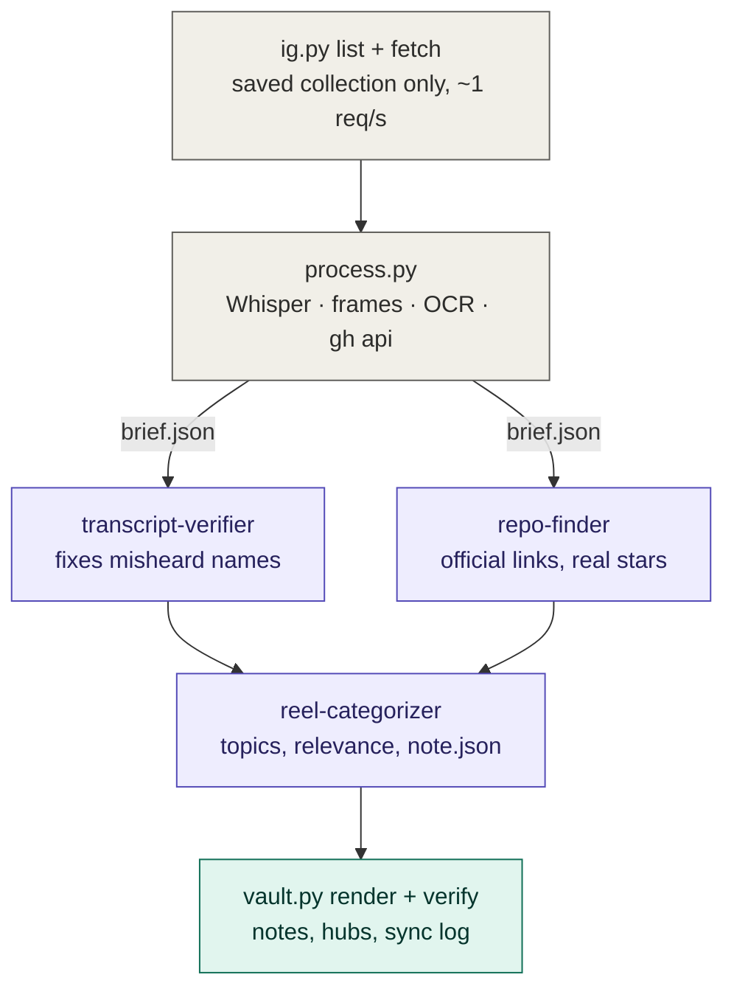

# reel-ingestion

Turn the Instagram reels you've saved into an Obsidian vault you'll actually use.

For each reel in the collections you choose, the pipeline:
- transcribes the audio and reads the on-screen text
- finds the real GitHub repo, docs or course page behind each tool it mentions, with real star counts
- writes one plain-language note: what it is, how it applies to *you*, setup steps and what to watch out for

It then files every note under topic, tool and collection hubs, and fills an Obsidian
Bases dashboard with *Quick wins* and *Worth trying* views.

You run it from [Claude Code](https://claude.com/claude-code). Python scripts do the mechanical
work for free. Three small Sonnet subagents do the parts that need judgment.

## How it works



| Step | Who | Tokens |
|---|---|---|
| List and download reels (Playwright, your own login) | `pipeline/ig.py` | none |
| Transcribe, grab frames, OCR, check GitHub repos | `pipeline/process.py` | none |
| Fix misheard names using subtitles and frames | `transcript-verifier` agent | small |
| Find official links, check hype, note risks | `repo-finder` agent | small–medium |
| Pick topics and relevance, draft the note | `reel-categorizer` agent | small |
| Render notes, update hubs, check every link | `pipeline/vault.py` | none |

## Requirements
- **macOS on Apple Silicon** (for [mlx-whisper](https://github.com/ml-explore/mlx-examples/tree/main/whisper)).
  On other systems, swap `transcribe()` in `process.py` for faster-whisper.
- Python 3.10+, [ffmpeg](https://ffmpeg.org/) (`brew install ffmpeg`)
- [GitHub CLI](https://cli.github.com/), logged in (`gh auth login`). It's used to check repos and star counts.
- [Claude Code](https://claude.com/claude-code) to run the agents
- [Obsidian](https://obsidian.md/) 1.9+ (for Bases)

## Setup
```bash
git clone <this repo> && cd reel-ingestion
python3 -m venv ~/reel-pipeline/.venv
~/reel-pipeline/.venv/bin/pip install -r pipeline/requirements.txt
~/reel-pipeline/.venv/bin/python -m playwright install chromium
cp config.example.yaml config.yaml
```
Edit `config.yaml`:
- `vault`: where the Obsidian vault should live
- `instagram_user`: your handle
- `topics`: your fixed topic list
- `profile`: a few lines about you; this drives the "For you" section and the relevance score

Then:
```bash
cd pipeline
~/reel-pipeline/.venv/bin/python vault.py init         # creates the vault skeleton
~/reel-pipeline/.venv/bin/python ig.py login           # log in yourself in the window that opens
~/reel-pipeline/.venv/bin/python ig.py collections     # prints your saved collections
```
Paste the collections you want into `collections:` in `config.yaml`. Anything not listed is never touched.

## Run it
Open Claude Code in this folder and say:

> Ingest the "my collection" collection.

[CLAUDE.md](CLAUDE.md) is the runbook it follows: scripts, then agents in parallel batches, then
render and verify. It stops and asks you when Instagram wants a login, when a run would add
more than `max_new_per_run` reels, or when a new topic seems needed.

Open the vault in Obsidian and start at **Start here**.

## Cost and tokens
- Transcription, OCR and rendering run locally and cost nothing.
- Agents run on Sonnet and read only one compact `brief.json` per reel (~1–2k tokens), not raw files.
  They reply with one line per reel, so the main session stays small.
- The main cost lever is `needs_verification()` in `pipeline/process.py`. It decides which
  transcripts are worth a verification call. It starts as "verify everything": tune it with
  Whisper's confidence scores to skip clean transcripts.
- Re-runs only process reels not yet in `.sync.json`.

## Safety rails built in
- **No invented links:** `vault.py render` removes any URL that didn't come from the reel, a
  successful `gh api` call or a page an agent opened, and reports it.
- **Fixed topics:** agents can only propose new topics. You approve them.
- **No overwrites, no deletes:** existing notes are never replaced, and your edits to `status` and `relevance` stay.
- **Allow-list:** only collections in `config.yaml` are read; `blocked:` wins over everything.

## ⚠️ Instagram terms
This tool reads Instagram's **private web API** with **your own logged-in browser session**.
That may break Instagram's Terms of Use, and Instagram can change or block it at any time. Use it at
your own risk, only on your own account, and only for posts you saved. It is rate-limited to about
one request per second and stops at the first sign of rate limiting or a login challenge. It never
types your password; you log in yourself.

## Layout
```
pipeline/       config.py · ig.py · process.py · vault.py
.claude/agents/ transcript-verifier · repo-finder · reel-categorizer (all model: sonnet)
template/       vault skeleton used by `vault.py init`
config.example.yaml
CLAUDE.md       runbook for Claude Code
```

## License
MIT. See [LICENSE](LICENSE).
